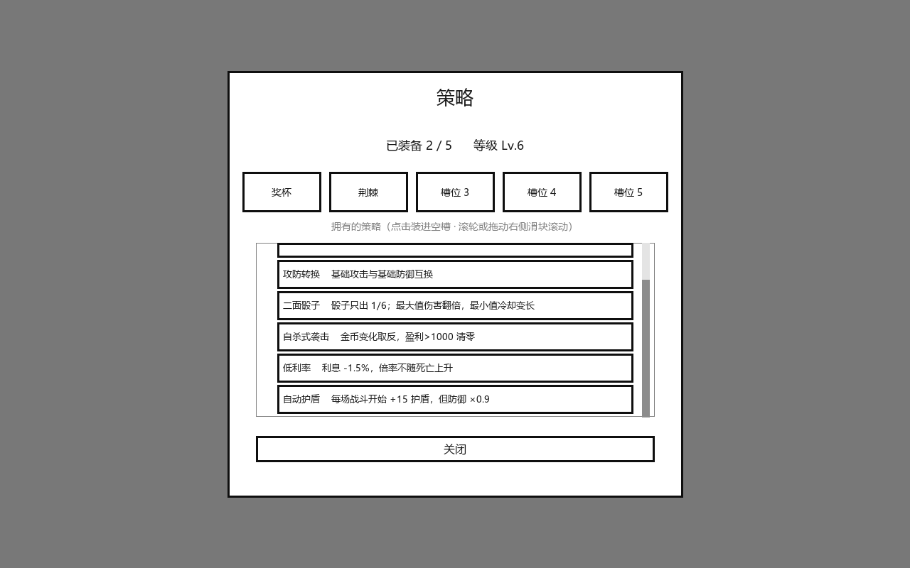
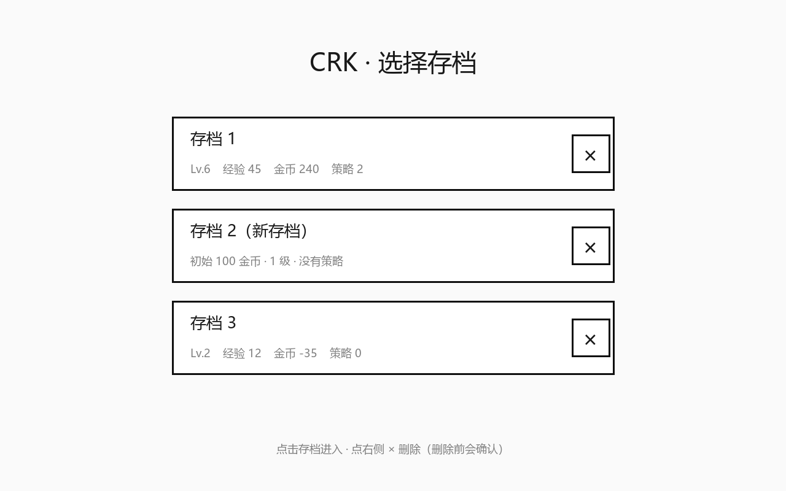
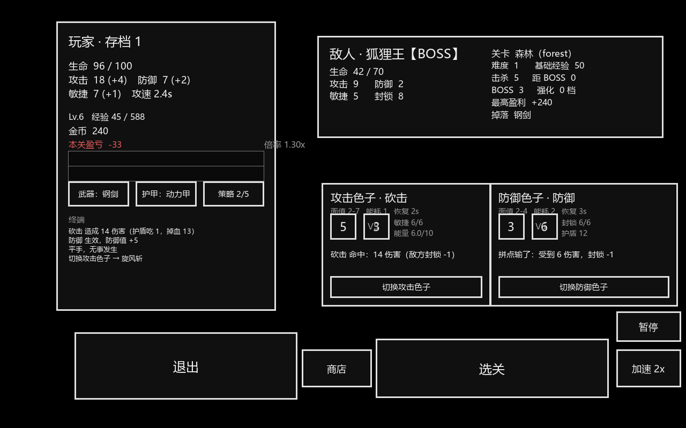

# CRK · 骰子自动战斗 Demo

Cocos Creator **3.8.8** 项目。**选择存档 → 选关 → 自动战斗**（攻击骰 / 防御骰双拼点）→ 打普通敌人攒进度 → 打 BOSS 掉装备 → 阵亡扣钱复活继续。

---

## 1. 怎么跑起来

1. 用 Cocos Creator 3.8.8 打开本目录（`package.json` 里已写死 creator 版本）。
2. 打开场景 `assets/scenes/SaveSelect.scene`（双击），点右上角预览 ▶ —— 先看到存档选择。
3. 左键点一个存档 → 自动切到 `Battle.scene` 开始玩；在战斗界面按 **Esc** 可以退出当前存档、回到存档选择。

> 也可以直接打开 `Battle.scene` 预览，会直接用上次选的那个存档开始（不会弹选择界面）。
>
> 可选：`项目设置 → 项目数据 → 设计分辨率` 改成 `1280 x 800` 会更贴合草图。
> UI 按 1280x800 布局并整体等比缩放，改不改分辨率都能正常显示。

---

## 2. 玩法流程

| 步骤 | 说明 |
| --- | --- |
| 选择存档 | 独立场景 `SaveSelect.scene`：3 个槽位，点整行进入、点右侧 ✕ 删除（先确认）；新存档 100 金币 |
| 选关 | 点「选关」弹窗挑关卡（`forest` / `factory` / `castle`），进去后**全自动**战斗 |
| 拼点 | 双方各一对色子（攻击 / 防御），**默认每秒拼一次**：玩家攻击色子对敌人防御色子、玩家防御色子对敌人攻击色子，规则见 3.13 |
| 技能 / 色子 | 攻击、防御色子各装一个技能，决定面值区间、能耗、破碎恢复时间；面板上的「切换攻击/防御色子」可以随时换 |
| 能量 | 上限 `Energy`、每 `Energy_recovery` 秒回 1 点；切换色子要花能耗；切防御色子会把当前防御值清零 |
| 耐久 | 玩家 `agility` 是攻击色子耐久、`blockade` 是防御色子耐久；掉到 0 色子破碎（一段时间不能用/不能切），恢复后耐久回满，敌人同理 |
| 普通敌人 | 击败后按 `Drop.rate` 掉落 buff（下一场战斗生效，或立即回血），并掉落金币；0.9 秒后自动刷下一个 |
| BOSS | 进入关卡时在 `[a, b]` 里随机一个 c；击败 c 个普通敌人后，下一个刷出来的就是 BOSS（面板显示「距 BOSS N」） |
| 击败 BOSS | 掉落**装备**（永久保存到本地存档）+ 一大笔金币，然后重新掷 c，继续刷普通敌人 |
| 装备 | 玩家面板有「武器 / 护甲」两个按钮，点开弹窗选择/卸下；属性在**每次战斗开始时**结算 |
| 金币 | 每击败一个敌人掉落 `敌人 Gold × sqrt(ln(a)+1)`（a = 本次关卡死亡次数），金币永久保存；玩家面板实时显示**本关盈亏**、**金币倍率**和**盈亏折线图** |
| 被击败 | **不退出关卡**：扣一笔金币（盈利的 4.5% 最低 80 / 亏损额的 5% 最低 100，每多死一次比例 +0.5%），按 `复活血量 = hp_origin / a`（a 最多算到 5）复活，继续打同一个敌人 |
| BOSS 强化 | 同一关每击败 5 个 BOSS，之后刷出来的敌人 攻击 ×1.25 / 生命 ×1.5 / 敏捷 +1 / 攻速 ×1.25（各有上限，见 3.11） |
| 最高盈利 | 每个关卡记录**单局最高盈利**（本局金币 − 进关时金币，可以是负数），关卡面板与选关弹窗都能看到（见 3.12） |
| 负债 | 金币被扣成负数就进入负债：**不能买东西**，并且每满 60 秒扣「当前负债的 5%」当利息 |
| 商店 | 不在关卡里时点「商店」，用金币买装备（装备会永久保存，可以马上装备） |
| 经验 | 击败敌人得 `ExpRate × 关卡 Exp`，被击败得 `3 × 关卡 Exp`；升级曲线 `E(n) = 100 · n^1.5` |
| 升级奖励 | 每 4 级攻击 +1、每 6 级防御 +1、每 2 级**有 50% 概率给技能、否则给策略**（不会同时给） |
| 策略 | 玩家面板「策略 x/5」打开弹窗，装进 5 个槽位；一共 12 条策略，效果见 3.9 |
| 存档 | 游戏开始时先选 3 个存档槽之一（新存档 100 金币），金币/装备/等级/技能都按槽分开保存（见 3.10） |
| 退出存档 | 在战斗界面按 **Esc** → 问「退出存档 N？」→ 是 → 回到 `SaveSelect` 场景 |
| 加速 | 右下角「加速」按钮在 **1x / 1.5x / 2x / 3x** 之间循环切换，只加快战斗推进（刷怪间隔也一起加快） |
| 暂停 | 右下角「暂停 / 继续」按钮，或者**按住空格**；暂停时战斗/能量/利息全部停住 |
| 退出 | 任何时候点「退出」回到选关状态 |

> 界面是**黑底白字**；战斗进度、防御值、距 BOSS 个数、当前掉落都显示在对应面板上，最近 5 条记录在玩家面板下方的「终端」里。

---

## 3. 战斗公式

> ⚠️ **3.1–3.5 是旧版（两颗六面骰 + 固定攻击间隔）的公式，已经被 3.13 的技能 / 能量 / 拼点系统替换**，
> 保留下来只是方便对照历史数值；实际运行的战斗逻辑在 `BattleEngine.ts`。

### 3.1 玩家攻击（拼点）

```
阈值 T = floor( 6 - (玩家敏捷 - 敌人敏捷) / 关卡难度 )     ← 默认 AGILITY_DIRECTION = -1，见 3.5
骰子和 = 2   → 必定失败
骰子和 = 12  → 必定成功
3-11        → 骰子和 > T 则命中，否则未命中
命中伤害 = max(1, 玩家 Atk - 敌人 Def)
```

- 骰子 = **两个六面骰**，和值 2-12。
- 面板上的「命中率」就是把 36 种和值全部枚举出来的真实概率（见 3.4）。

### 3.2 玩家防御（拼点，对手是敌人的 blockade）

```
阈值 T = floor( 6 - (玩家敏捷 - 敌人 blockade) / 关卡难度 )
判定方式和攻击完全一样（2 必失败、12 必成功、其余 和值 > T）
成功一次：本场战斗的防御值 += 玩家 Def
```

- `blockade` 越高，玩家越难防住（因为阈值被抬高）。
- 防御值是一个**护盾池**：除了被伤害扣掉以外只增不减，一直保留到这场战斗结束，换敌人才清空。
- 面板上的「成功率」同样是把 36 种和值枚举出来的真实概率，下面的「防御值」就是护盾池当前值。

### 3.3 敌人攻击（100% 命中，先扣防御值）

```
打出伤害 = max(1, 敌人 Atk)
吸收     = min(当前防御值, 打出伤害)
扣血     = 打出伤害 - 吸收
防御值   = 防御值 - 吸收
```

- 敌人不再投骰，蓄力 `Speed` 秒 + 出手 `Atk_gap` 秒后必定造成伤害。
- 伤害**优先被防御值吃掉**：防御值够就完全不掉血，不够的话差额才扣血。
- 所以防御骰很关键，但也不是无敌：防御值会被打空，需要靠下一次防御骰补回来。

### 3.4 伤害与最小伤害

`max(1, ...)` 的下限避免「攻低防高」时双方永远打不死（改动入口：`BattleCore.ts` 的 `MIN_DAMAGE`）。

### 3.5 ⚠️ 敏捷方向开关

```ts
export const AGILITY_DIRECTION = -1;  // -1 = 敏捷越高越强（当前默认）；1 = 严格按需求原文
```

- `-1`：阈值 = `6 - (攻方敏捷 - 守方敏捷)/难度`，敏捷高 → 更容易命中、更难被打中（符合直觉）。
- `+1`：需求原文方向，敏捷高反而更吃亏，`Agility_up` 会变成负面效果。

之前按 `+1` 实测过：玩家（敏捷 6）打狐狸（敏捷 3）命中率只有 16.7%，狐狸打玩家 91.7%，必输。所以默认用 `-1`。

### 3.6 货币 / 复活 / 负债（`Economy.ts`）

```
击败敌人掉落金币 = 敌人 Gold × sqrt(ln(a) + 1)        a = 本次关卡「有效」死亡次数（a<1 按 1 算）
被击败扣金币    = 本局盈利 × 4.5%（最低 80） / 本局亏损额 × 5%（最低 100），每多死一次比例 +0.5%    扣成负数就进入负债
复活血量        = hp_origin / a                        a 最多算到 5 → 复活血量不低于 20%
负债利息        = 当前负债额 × 5% / 每分钟
死亡 > 15 次后   = 倍率重新按 a=1 往上算（1.0x 起），复活血量固定 10%
```

- 金币、装备、等级都存 localStorage，并且**按存档槽分开**（`crk_slot1_gold` 这种，见 3.10），重开预览还在。
- 死亡次数 `a` 在每次进入关卡时清零；第一次死亡 a=1（满血复活），之后 50% / 33% / 25% / 20%，再往后固定 20%。
- **一局内死亡超过 15 次**：金币倍率重新从 `a=1`（1.0x）开始涨（第 16 次 = 1.0x、第 17 次 = 1.30x…），
  同时复活血量**固定 10%**，不会继续掉。
- 金币倍率用的是**有效死亡次数**（`multiplierDeaths`），「奖杯」策略的 +0.2 也跟着这个计数重置。
- 负债利息只在游戏运行时累计（关掉预览期间不扣）；负债期间商店里所有商品都点不动。
- 想调数值：`Economy.ts` 顶部的 `REVIVE_PROFIT_RATE` / `REVIVE_PROFIT_MIN` / `REVIVE_LOSS_RATE` / `REVIVE_LOSS_MIN`、
  `DEBT_INTEREST_RATE`、`REVIVE_MIN_RATIO`、`REVIVE_RESET_DEATHS`、`LATE_REVIVE_RATIO`。

### 3.7 BOSS 特殊规则（`enemies.json` 里的 `special`）

目前只有城堡守卫（`castle_guardian`）在用，字段都是可选的：

| 字段 | 效果 |
| --- | --- |
| `goldOnHitPlayer` | 主角击中 BOSS 时 +金币（城堡守卫 = 10） |
| `goldOnPlayerDamaged` | 主角被 BOSS **打掉血**时扣金币（-55），被完全格挡不算 |
| `agilityDownOnHitPlayer` | 主角击中 BOSS 后，**下一次攻击**的敏捷 -1（用完清零，不叠加到整场） |
| `agilityDownOnFullBlock` | 主角**完全格挡**后 BOSS 敏捷 -1 |
| `blockadeUpOnFullBlock` | 主角**完全格挡**后 BOSS blockade +1（下次更难挡） |

城堡关卡（`levels.json` 的 `castle`，diff 2，小怪 knight / archer / mage）：BOSS 是 `castle_guardian`，
`Hp 100 / Atk 55 / Speed 3.0 / Agility 6 / blockade 6`，掉落「守卫者之刃」+ 250 金币。

> 实测（钢剑 + 动力甲）：能打赢，但大约 39 秒、死 4 次、金币净 **-745** —— 这关的 BOSS 就是个金币绞肉机。
> 觉得太狠就调 `castle_guardian` 的 `Atk`、`Hp`，或者把 `goldOnPlayerDamaged` 从 -55 改小一点。

### 3.8 经验 / 等级（`Progress.ts`）

```
击败敌人经验 = 敌人 ExpRate × 关卡 Exp
被击败经验   = 3 × 关卡 Exp
升级所需经验 = E(n) = 100 × n^1.5      n = 当前等级（1 级升 2 级就是 100）
```

| 等级 | 奖励 |
| --- | --- |
| 每 4 级（4/8/12…） | 攻击 +1 |
| 每 6 级（6/12/18…） | 防御 +1 |
| 每 2 级（2/4/6…） | 随机获得一条**还没拥有**的策略 |

- 等级 / 经验 / 已获得策略 / 策略槽都存在 localStorage（跟着**存档槽**走，见 3.10），和金币一样永久保存。
- 升级加成是**按等级累计**的（`floor(level/4)` 点攻击、`floor(level/6)` 点防御），不需要另外存档。
- 想改曲线：`Progress.ts` 顶部的 `EXP_BASE` / `EXP_POWER`。

### 3.9 策略（`Strategies.ts`）

每升 **2** 级拿一条随机策略，装进 **5 个策略槽**（玩家面板「策略 x/5」按钮打开弹窗装备/卸下）。



- 上面是 5 个槽位（点一下卸下），下面是「已获得但没装备」的列表；列表太多时是**可滚动**的：
  视口用 `Mask` 裁切；**滚轮往下滚 = 列表往下翻**（每次一格 = 44px）；右侧滚动条既能看位置，
  也能**按住拖动**（热区 24px、滑块最短 24px，按住时会记下手指与滑块中心的偏移，所以不会突然跳）。
装备/卸下的改动**从下一场战斗开始生效**，不会中途改掉正在打的那一场。

| 策略 | 效果 |
| --- | --- |
| 斐波那契 | **每颗骰子**只出斐波那契面值 **2 / 3 / 5**（不含 1，也不会到骰子最大值 6）；和值只会是 4/5/6/7/8/10，所以既不会 2 必失败、也拿不到 12 必成功 |
| 奇数性 | 奇数骰面 ×2；两骰皆奇数必定成功并 **+100 金币**（1+1 除外）；偶数骰面归 0；两骰皆偶数扣**本局盈利 5%**（亏损不扣） |
| 攻防转换 | 基础攻击与基础防御互换（装备加成不受影响） |
| 荆棘 | 受到未被格挡的伤害时，把等量伤害反弹给敌人（可以反杀） |
| 奖杯 | 金币倍率每提升一次（每次死亡），额外 +0.2 倍 |
| 二面骰子 | 玩家色子只出**最小/最大面值**；出最大面值时伤害/防御 **×2**（原来的「最小值冷却变长」已取消） |
| 自杀式袭击 | 本局**所有金币变化取反**；本局盈利超过 1000 时金币清零；一局超过 50 秒强制结束关卡（保留盈亏） |
| 低利率 | 负债利息 5% → **3.5%**，且金币倍率不再随死亡次数上升 |
| 敏捷 | 玩家敏捷 +1 |
| 玻璃大炮 | 玩家攻击 ×3，但**防御骰必然投出最小值**（1+1，永远防不住 → 护盾不会自己涨，只能靠「自动护盾」这类外部来源） |
| 自动护盾 | **每场战斗开始先给 15 点护盾**（`AUTO_SHIELD`），代价是玩家防御 ×0.9（取整） |
| 血瓶 | 每场战斗结束（击败敌人）回复 **10 点血量** |

- 多条「骰子类」策略同时装备时的顺序：先 2d6 → 二面骰子锁 1/6 → 斐波那契把**每颗**骰子锁成 2/3/5
  → 玻璃大炮把**防御骰**锁成 1+1（优先级最高，会盖掉前面的结果）→ 奇数性变换面值。
- 「攻防转换」只作用于**基础数值**（配置值 + 等级加成），装备加成最后再加；「玻璃大炮」的攻击 ×3 也是乘在基础攻击上。
- 「自杀式袭击」的 50 秒按 1x 速度的真实秒数算，加速按钮不会让它提前触发。

### 3.10 存档（`Save.ts` + 独立场景 `SaveSelect.scene`）

存档选择现在是**一个独立场景**（不是弹窗），两个场景之间用 `director.loadScene` 来回切：

```
SaveSelect.scene  ──左键点存档──▶  Battle.scene
       ▲                              │
       └────── Esc →「退出存档？」是 ──┘
```



- 一共 **3 个存档槽**，`SaveSelect` 场景里能看到每个槽的 Lv./经验/金币/策略数。
- **新存档自带 100 金币**（`Save.START_GOLD`）、1 级、0 经验、没有策略；点进去时先落盘再切场景。
- 每个槽的数据分开存：`crk_slot1_gold` / `crk_slot1_equipment` / `crk_slot1_progress`（2、3 号槽同理），
  上次选的槽记在 `crk_current_slot_v1`；战斗界面玩家面板标题显示「玩家 · 存档 N」。
- 老版本（没有槽位时）的 `crk_gold_v1` / `crk_equipment_v1` / `crk_progress_v1` 会在首次启动时**自动搬进 1 号槽**，不会丢进度。
- **删除存档**：每行存档**右侧有个 ✕**，点它会弹出确认框（显示这个槽的等级/金币/策略）→
  点「删除」才会真的清掉（`Save.resetSlot`，三个 key 一起删）；点「取消」或按 Esc 关掉确认框；空槽点 ✕ 不弹框。
- **退出存档**：战斗界面按 **Esc** → 「退出「存档 N」？」→ 点「是」回到 `SaveSelect` 场景（进度早已即时保存）；
  如果当时已经开着别的弹窗，Esc 会先关那个弹窗。
- 想清空某个槽也可以用控制台：`localStorage.removeItem('crk_slot2_gold')`，或者调 `Save.resetSlot(2)`。

### 3.11 本关 BOSS 强化（`BattleCore.escalateEnemyStats`）

同一次关卡里**每击败 5 个 BOSS**，之后刷出来的敌人整体强化一档（对已经刷出来的敌人不追溯）：

| 属性 | 每档 | 上限 |
| --- | --- | --- |
| 攻击力 | ×1.25 | 原始的 **5 倍** |
| 生命值 | ×1.5 | 原始的 **10 倍** |
| 敏捷 | +1 | 不超过**主角敏捷 +4** |
| 攻击速度 | ×1.25 | 原始的 **3 倍**（`Speed` 存的是攻击间隔，所以这里是间隔 ÷1.25） |

- 档位 = `floor(本关 BOSS 击杀数 / 5)`；关卡面板会显示「BOSS 击杀数 / 强化档位」。
- 上限都是相对 `enemies.json` 里的**原始值**算的，不会无限叠加（攻击 5 倍、生命 10 倍、攻速 3 倍各自封顶）。
- 数值全在 `BattleCore.ts` 顶部：`BOSS_TIER_KILLS` / `BOSS_ATK_STEP` / `BOSS_ATK_CAP` / `BOSS_HP_STEP` / `BOSS_HP_CAP` /
  `BOSS_SPEED_STEP` / `BOSS_SPEED_CAP` / `BOSS_AGILITY_LEAD`。

### 3.12 关卡最高盈利（`Records.ts`）

- 每关单独记一个「单局最高盈利」= `本局金币 − 进关时金币` 的历史最大值。
- 结算时机：点「退出」/ 按 Esc 退出存档 / 被「自杀式袭击」50 秒强制结束关卡，都会结算一次（只增不减）。
- **现在允许是负数**：一局都没赚过就会显示 `最高盈利 -500`（第一次结算哪怕亏钱也会记下来）。
- 跟着存档槽存：`crk_slot1_records` 这种 key；删存档时一起清掉。
- 显示位置：关卡面板一行 `最高盈利 +240` / `-500`，选关弹窗每行下面也会显示。

### 3.13 技能 / 能量 / 拼点（`Skills.ts` + `BattleEngine.ts`，新战斗模型）

旧的「两颗六面骰 + 攻击间隔」已经去掉，改成**按回合推进：1 回合 = 1 秒，每回合两条战线各拼一次点**。
`Speed / Atk_gap / def_gap` 这些时长字段已经不再影响战斗（`player.json` 里也删掉了）。

**一个技能 = 一个色子**：

| 字段 | 含义 |
| --- | --- |
| 面板（`desc`） | 说明带来的伤害/防御以及特殊机制 |
| 能耗（`energy`） | 切换到这个色子要花的能量 |
| 色子面值（`faceMin`~`faceMax`） | 每次拼点在这个区间里取值 |
| 恢复时间（`recovery`） | 色子破碎之后多久恢复 |

**拼点规则**（1 次/秒，`BattleEngine.ts`）：

```
攻击线：玩家攻击色子  VS  敌人防御色子
  我方高 → 按技能面板对「敌人防御值」造成伤害（溢出打血），敌人 blockade -1
  敌方高 → 敌人防御值 +敌人 Def，玩家 agility -1
  相等   → 无事发生

防御线：玩家防御色子  VS  敌人攻击色子
  我方高 → 按技能面板加「玩家防御值」，敌人 agility -1
  敌方高 → 按敌人 Atk 打「玩家防御值」（溢出打血），玩家 blockade -1
  相等   → 无事发生
```

- **agility 是攻击色子的耐久，blockade 是防御色子的耐久**：掉到 0 色子就碎（攻击色子碎了不能攻击/切换，防御色子碎了一并清空防御值，都不能切换），
  破碎时间结束后耐久回满；敌人的敏捷/封锁同理（敌人色子破碎固定 3 秒）。
- **能量**：上限 `Energy`、每 `Energy_recovery` 秒回 1 点；切换色子花掉对应能耗。
- **切换**：任意时刻都能切；**切防御色子会把当前防御值清零**。面板上的「切换攻击色子 / 切换防御色子」按钮打开技能列表。
- 敌人没有技能配置：攻击色子面值按 `1 ~ round(Atk/3)`、防御色子按 `1 ~ max(2, blockade)` 推算（`defaultEnemyAttackFace/DefenseFace`）。
- 策略里和骰子有关的几个（斐波那契 / 奇数性 / 二面骰子 / 玻璃大炮）现在作用在**玩家色子的面值**上；
  「攻防转换 / 玻璃大炮的攻击 ×3 / 敏捷」还是加在基础属性上。

**技能一览**（新存档默认带 砍击 / 防御 / 闪避）：

| 技能 | 类型 | 面板 | 能耗 | 面值 | 恢复 |
| --- | --- | --- | --- | --- | --- |
| 砍击 | 攻击 | 1 倍 atk 伤害 | 1 | 2-7 | 2s |
| 防御 | 防御 | 1 倍 def 护盾 | 2 | 2-4 | 3s |
| 闪避 | 防御 | 面值高于对方攻击色子时抵消全部伤害（不加防御值） | 0 | 1-9 | 1s |
| 旋风斩 | 攻击 | 3 次 0.333 倍 atk | 1 | 1-9 | 2s |
| 蓄力打击 | 攻击 | 1.2 倍 atk，命中后力量 +1（2s 内再 +0.5 倍 atk） | 2 | 3-5 | 3s |
| 重击 | 攻击 | 1 倍 atk，命中后敌方防御色子上限 -2（不低于 1） | 1 | 1-5 | 2s |
| 贿赂 | 防御 | 不提供防御，金币获取倍率 +0.5 | 3 | 1 | 4s |
| 抢夺 | 防御 | 躲闪，额外 +50 金币 | 2 | 1-5 | 2s |
| 巩固 | 防御 | 3 秒后生效（无视拼点结果，拼点失败照样扣 blockade），提供 10 倍 def | 2 | 5 | 3s |
| 黄金要塞 | 防御 | 护盾 = 面值 × def，同时扣「面值 × 100」金币 | 2 | 2-7 | 3s |

**升级奖励**：每 2 级**有 50% 概率给技能，否则给策略**（不会同时给两条），技能不会重复；
玩家面板的「Lv/x 经验」下面就能看到，战斗中随时可以换色子。

**暂停**：右下角「暂停 / 继续」按钮，或者**按住空格**；暂停时战斗、能量、利息都停。

> ✕ 按钮是独立的 62x62 小面板，`TOUCH_START`/`TOUCH_END` 里都会 `propagationStopped = true`，
> 所以点它不会顺带触发整行的「进入存档」。

---

## 4. 配置文件

四份 JSON 都在 `assets/resources/config/` 下，改完**不用重新编译脚本**，重新预览即可生效
（改完编辑器没反应的话，点一下编辑器窗口让它刷新资源，或者重启编辑器）。

> ⚠️ **JSON 里不要用 `constructor` / `__proto__` / `prototype` 当键名。**
> Cocos 的导入和序列化用 `obj.constructor === Object` 判断“普通对象”，一旦某个对象带自己的 `constructor` 键，
> 整份文件会被当成非普通对象，导入结果是**空**（`asset.json === null`），运行时直接报
> `Cannot read properties of null (reading 'xxx')`。`Config.ts` 启动时会扫描这类键名并给出可读的报错。

### 4.1 `player.json`（玩家）

```json
{ "Hp": 100, "Sp": 10, "Atk": 14, "Agility": 6, "Def": 5, "Speed": 2.4, "Atk_gap": 0.6, "def_gap": 1.8 }
```

| 字段 | 含义 |
| --- | --- |
| `Hp` | 生命上限，也是每次进入关卡时的血量 |
| `Sp` | 法力，**只显示、不参与战斗**（留给以后的技能系统） |
| `Atk` | 攻击力 |
| `Agility` | 敏捷，参与攻击拼点和防御拼点 |
| `Def` | **每次防御骰成功时给护盾池加的量**（不是常驻防御力） |
| `Speed` | 攻击间隙（秒） |
| `Atk_gap` | 攻击骰的表现时间（秒） |
| `def_gap` | 防御间隙（秒）：每隔这么久掷一次防御骰 |

### 4.2 `enemies.json`（敌人，BOSS 也是这里的条目）

```json
"fox": { "Hp": 24, "Atk": 6, "Atk_gap": 1.0, "Speed": 2.0, "Def": 1,
         "Agility": 3, "blockade": 5,
         "Drop": { "type": "Agility_up", "rate": 0.2 } }
```

| 字段 | 含义 |
| --- | --- |
| `Hp` / `Atk` / `Def` / `Agility` / `Speed` / `Atk_gap` | 同上（`Agility` 参与玩家攻击拼点） |
| `blockade` | **防御拼点里敌人这一方的值**，越高玩家越难防住 |
| `Gold` | 击败后掉落的基础金币（会乘上当前金币倍率 `sqrt(ln(a)+1)`） |
| `ExpRate` | 经验倍率：击败它获得 `ExpRate × 关卡 Exp` 经验（小怪 0.8~3.5，BOSS 5~10） |
| `Drop.type` / `Drop.rate` | 普通敌人的奖励类型与掉落概率（见 4.5） |
| `Drop.equip` | 当 `Drop.type` 为 `Equip` 时掉落的装备 id（BOSS 用，见 4.4） |
| `special` | 可选，BOSS 特殊规则（击中给钱/挨打扣钱/敏捷变化），见 3.7 |

### 4.3 `levels.json`（关卡 + BOSS）

```json
"forest": {
  "name": "森林",
  "diff": 1,
  "Enemy": [
    { "enemy": "fox",  "spawn_rate": 0.5 },
    { "enemy": "wolf", "spawn_rate": 0.3 },
    { "enemy": "bat",  "spawn_rate": 0.2 }
  ],
  "boss": { "enemy": "fox_king", "a": 3, "b": 6 }
}
```

| 字段 | 含义 |
| --- | --- |
| key（`forest`） | 关卡 id |
| `name` | 可选，界面显示用 |
| `diff` | 关卡难度，参与拼点阈值计算（越大敏捷差影响越小） |
| `Exp` | **本关基础经验**：击败敌人得 `ExpRate × Exp`，死亡得 `3 × Exp`（森林 50 / 工厂 80 / 城堡 120） |
| `Enemy[].enemy` / `.spawn_rate` | 普通敌人 id 与刷新权重（建议和为 1，不等于 1 会按比例归一） |
| `boss.enemy` | BOSS 的敌人 id（同样配在 `enemies.json` 里） |
| `boss.a` / `boss.b` | 每次进入关卡 / 击败 BOSS 后，在 `[a, b]` 里随机一个 c，击败 c 个普通敌人后刷 BOSS（b 要大于 a，写反了会自动交换） |

### 4.4 `equipments.json`（装备）

```json
"rusty_sword": { "name": "旧短剑", "slot": "weapon", "Atk": 2, "price": 60 },
"steel_sword": { "name": "钢剑", "slot": "weapon", "Atk": 4, "price": 150 },
"power_armor": { "name": "动力甲", "slot": "armor", "Def": 2, "Agility": 1, "price": 260 },
"guardian_blade": { "name": "守卫者之刃", "slot": "weapon", "Atk": 6, "price": 420 }
```

| 字段 | 含义 |
| --- | --- |
| `name` | 显示名 |
| `slot` | `weapon`（武器槽）或 `armor`（护甲槽） |
| `Atk` / `Def` / `Agility` | 战斗开始时加成的属性（`Def` 加的是“每次防御骰获得的防御值”） |
| `price` | 商店售价（金币）；不配会按 0 金币出售 |

- 装备来源有两个：**BOSS 掉落**（免费）和**商店购买**（花金币）。
- 装备**永久保存**在浏览器 localStorage（按存档槽：`crk_slot1_equipment`），重开预览也还在。
- 同一件装备只会在背包里存在一份；换槽位、卸下都会立即保存。

### 4.5 普通敌人掉落（`BattleCore.ts` 的 `DROP_EFFECTS`）

| type | 效果 |
| --- | --- |
| `Agility_up` | 下一场战斗 敏捷 +1 |
| `Atk_up` | 下一场战斗 攻击 +2 |
| `Hp_heal` | 立即回复 10 点生命（不超过上限） |

- 「下一场战斗」类效果：战斗结束时记下，**下一场开打时生效、只作用于那一场**，可以叠加。
- BOSS 用 `Equip` 类型掉落装备（不进这张表）。

---

## 5. 代码结构

```
assets/
  scenes/
    SaveSelect.scene            存档选择场景（Canvas + Camera + SaveSelect 组件）
    Battle.scene                Canvas + Camera + Game(BattleGame) —— 场景里只有骨架，UI 全部由代码创建
  scripts/
    BattleCore.ts              纯逻辑：敌人配置 / BOSS 进度 / BOSS 强化 / 掉落 / 金币倍率（旧拼点类已弃用）
    BattleEngine.ts            新拼点引擎：双方攻防色子、每秒拼点、耐久/破碎、能量、技能效果
    Skills.ts                  攻击/防御技能定义（面值区间、能耗、恢复、特殊机制）
    Economy.ts                 金币 / 复活血量 / 金币倍率 / 负债利息 + 存档读写
    Progress.ts                等级 / 经验曲线 / 升级奖励 / 策略槽 + 存档读写
    Save.ts                    3 个存档槽、初始 100 金币、旧存档迁移、槽位概览、删除
    Records.ts                 每个关卡的单局最高盈利（跟着存档槽保存）
    Strategies.ts              12 条策略的定义、文案、装备效果开关
    Equipment.ts               装备数据、属性加成、按存档槽保存
    Config.ts                  resources.load 读取四份 JSON + 启动校验
    UIFactory.ts               面板/文字/按钮/弹窗（用 Graphics 画，不需要任何图片资源）
    SaveSelect.ts              存档选择界面：3 个槽、左键进入 / 右键删除（带确认）、切场景
    BattleGame.ts              主流程组件：布局、阶段切换、经验/金币结算、复活、Esc 退出存档、各种弹窗
  resources/config/*.json      player / enemies / levels / equipments
docs/layout.png                UI 布局示意图（按 BattleGame.ts 里的坐标画的近似稿）
docs/save-select.png           存档选择场景示意图
docs/strategy-popup.png        策略弹窗（含可滚动列表）示意图
```

### 界面（按你最新草图）



| 草图 | 实现 |
| --- | --- |
| 左侧大框「玩家信息、终端」 | 标题显示「玩家 · 存档 N」；属性（3 行紧凑排版）+ **Lv/经验** + **金币**（负债变红并显示每分钟利息）+ **本关盈亏 / 倍率 / 折线图** + 武器/护甲/**策略** 三个按钮 + 底部 6 行战斗记录 |
| 右上框「敌人、关卡信息」 | 左半边敌人（名字/生命/攻击/防御/敏捷/封锁/进度），右半边关卡（关卡/难度/击杀/距 BOSS/BOSS 击杀与强化档位/最高盈利/掉落），中间竖线分隔 |
| 中右「攻击色子」 | 两颗骰子 + 和值 + 命中结果 + **当前攻击伤害** + 命中率 + 蓄力进度 |
| 中右「防御色子」 | 两颗骰子 + 和值 + 防御结果 + **当前防御值** + 成功率 + 下次防御倒计时 |
| 左下「退出」 | 按钮，回到选关状态 |
| 底部「商店」 | 按钮，不在关卡里时可用，弹出商店窗口买装备 |
| 底部「策略 x/5」 | 按钮，弹出策略弹窗：5 个槽位 + 一个**可用滚轮上下滚**的已获得策略列表，点一下装备/卸下 |
| 开局场景「存档选择」 | 独立场景 `SaveSelect.scene`：3 行存档槽（标题/等级/经验/金币/策略数），点整行进入、点右侧 ✕ 删除（会先确认） |
| 右下「选关」 | 按钮，弹出关卡选择窗口（每关显示 难度 / BOSS / 最高盈利） |
| 右下角「加速」 | 按钮，在 1x / 1.5x / 2x / 3x 之间循环，按钮文字显示当前倍率 |

- 布局以 **1280x800** 为基准，运行时整体等比缩放（`min(宽/1280, 高/800)`）。
- 面板/按钮/弹窗都用 `Graphics` 画描边，文字用系统字体，整个 Demo **不需要一张图片资源**。
- **盈亏折线图**：横轴是本关经过的时间，纵轴是「当前金币 − 进关时金币」的累计值，中间灰线是 0；
  每次击杀 / 复活 / 利息都会记一个点，最后一次是亏损时线变红、盈利时绿色，进关卡时重置。

---

## 6. 自测

- **类型检查**：

```powershell
node "C:\ProgramData\cocos\editors\Creator\3.8.8\resources\app.asar.unpacked\node_modules\typescript\lib\tsc.js" `
     -p tsconfig.json --noEmit --skipLibCheck
```

- **纯逻辑自测**：`BattleCore.ts` / `Economy.ts` 不依赖 `cc`（`Economy` 只有存档用到 `sys.localStorage`），可以编译成 commonjs 后在 node 里跑：

```powershell
node "<同上>/typescript/lib/tsc.js" assets/scripts/BattleCore.ts assets/scripts/Economy.ts `
     assets/scripts/Progress.ts assets/scripts/Strategies.ts `
     --target ES2019 --module commonjs --outDir tools/build --skipLibCheck
```

> 独立编译没带项目 tsconfig 的话会提示一条 `Cannot find module 'cc'`（`Economy.ts` 里存档用到 `sys.localStorage`），
> 不影响生成的 js，测试脚本里用一个假的 `cc` 模块顶上就行。项目内（`tsc -p tsconfig.json`）是没有这个报错的。

用 `createUnit / Battle / newLevelProgress` 就能复现整个战斗循环（敌人 100% 命中、防御值累积、BOSS 进度、倒下→复活、掉落）。
补充：`Battle` 在玩家血量为 0 时**不会结束**，而是发 `playerDown` 事件并暂停，外部调 `battle.revive(hp)` 后继续。
当前数值的模拟结果（每关跑 200 个随机种子）：

| 配置 | 平均击杀 | 打到 BOSS | 击杀 BOSS |
| --- | --- | --- | --- |
| forest 空装备 | 10.5 | 100% | 99% |
| forest 带钢剑 | 12.8 | 100% | 100% |
| factory 空装备 | 2.0 | 5% | 0% |
| factory 带钢剑+动力甲 | 5.0 | 62% | 16% |

带复活的经济模拟（森林，100 个种子）：平均击杀 30.5 个、复活 7.4 次、结束时平均还剩 91.5 金币 —— 复活费（80/次）基本能把一轮的收入吃掉，想攒钱进商店就得少死。

城堡守卫（钢剑 + 动力甲，实测一场）：BOSS 会被打死，用时约 39 秒、角色死 4 次、金币净变化 **-745**；
特殊规则也单独验证过：击中 BOSS 必定 +10 金币且下一次攻击敏捷被扣、被打掉血必定 -55、完全格挡时 0 伤害且不扣钱、同时 BOSS 敏捷 -1 / blockade +1。

经验 / 等级 / 策略这一套单独跑了 **32 项断言**（全过），覆盖：
`E(1)=100`、`E(2)=283` 的曲线、4 级攻击 / 6 级防御 / 2 级给策略且不重复、
斐波那契骰每颗只出 2/3/5、奇数性双奇必中 +100 与双偶扣 5%、二面骰子只出 1/6 且能区分最大/最小值、
荆棘能在挨打时反伤、金币倍率与 3.5% 低利率利息、以及「每个关卡都有 Exp / 每个敌人都有 ExpRate」的配置完整性。

存档槽又单独跑了 **29 项断言**（全过）：3 个槽位互相隔离（同一时间 1 号 500 金币、2 号 -35、3 号 999 互不影响）、
新槽读出来是 100 金币、存过 0 金币的槽不会被当成新存档、等级/策略数能在槽位概览里读对、
清空槽位后回到「新存档」状态、上次选的槽位会被记住、旧版 `crk_*_v1` 存档能自动迁移进 1 号槽且不会重复迁移，
以及「每 2 级给一条策略」（2 级 1 条、4 级 2 条、6 级 3 条）。

BOSS 强化 + 死亡惩罚又跑了 **28 项断言**（全过）：
4/5/10 个 BOSS 的档位与数值、敏捷封顶「主角 +4」（含高敏捷敌人不被拉低）、攻击 5 倍 / 生命 10 倍 / 攻速 3 倍各自封顶、
死亡惩罚在盈利（4.5% 与最低 80）、亏损（5% 与最低 100）、不赚不亏、负债状态下都算对，
每多死一次比例 +0.5%（第 1 次 4.5%/5%，第 2 次 5%/5.5%，第 5 次 6.5%/7%）。

最高盈利纪录再跑了 **21 项断言**（全过）：每关独立记录、只增不减、亏损不写纪录、
跨存档槽隔离（1 号 300 / 2 号 999）、删档清空纪录、脏数据（字符串/负数）被过滤。

- **配置校验**：`Config.ts` 启动时会检查四份 JSON（空文件、`constructor` 这类禁用键名、
  关卡引用了不存在的敌人、`spawn_rate` 之和、`blockade` / `def_gap` 等新字段、
  `Equip` 掉落是否指向存在的装备）。有问题打到控制台 warning；整份读不出来时会把原因显示在「敌人、关卡信息」面板上。

---

## 7. 实现取舍（需求里没写死的地方）

1. **防御值的含义**：一个护盾池 —— 防御骰成功一次 `+玩家 Def`；敌人伤害**先扣防御值、扣完才扣血**；防御值在战斗内一直保留（不会被重置），换敌人清空。
2. **def_gap**：定义为防御间隙（多久掷一次防御骰），和攻击的 `Speed` 是两条独立节奏，所以 UI 上分成两个色子面板。
3. **BOSS 触发条件**：在 `[a, b]` 随机 c，击败 **c** 个普通敌人后刷 BOSS；每击败一次 BOSS 重新掷 c。
4. **BOSS 掉落**：`Drop.type = "Equip"` + `Drop.equip = 装备 id`，装备永久存 localStorage（同一件不重复获得）。
5. **装备生效时机**：每次战斗开始时结算（战斗中换装不影响当前这场）。
6. **敌人 100% 伤害**：保留 `Atk_gap` 作为出手动作时间，伤害在出手结束时结算。
7. **敏捷方向**：默认 `AGILITY_DIRECTION = -1`（敏捷越高越强，见 3.5）；要严格按原文就改成 `1`。
8. **关卡选择**：点「选关」弹窗，随时可以换关卡（换了就重开本轮）。
9. **敌人中文名**：写在 `BattleGame.ts` 的 `ENEMY_NAMES` 里，没配的敌人直接显示 id。
10. **配置键名**：`constructor` / `__proto__` / `prototype` 不能当 JSON 键名，见第 4 节。
11. **复活血量**：`a`（死亡次数）最多算到 5，复活血量不低于 20%；第一次死亡 a=1 也就是满血复活。
12. **金币倍率**：`sqrt(ln(a)+1)` 用的是**有效死亡次数**（超过 15 次后重新从 1 数），和复活血量的 a 是分开算的。
13. **死亡惩罚**：按**本局盈亏**算 —— 盈利扣 4.5%（最低 80），亏损扣亏损额 5%（最低 100）；
    **每多死一次比例 +0.5%**（用的是这次死亡之前的死亡次数，所以第一次不加成）；可以扣成负数进负债。
    「本局盈亏」= 当前金币 − 进关时的金币，和面板上的「本关盈亏」是同一个值。
14. **负债利息**：每满 60 秒扣一次「当前负债 × 5%」，只在游戏运行时累计；负债期间商店全部不可购买。
15. **死亡不再退出关卡**：原来的战败弹窗已经去掉了，想结束本轮只能点「退出」。
16. **升级曲线**：`E(n) = 100 · n^1.5`（原文只给了 `a·n^p`，指数取 1.5 让前几级升得快、后面慢慢变陡），改 `Progress.ts` 的 `EXP_POWER` 即可。
17. **经验来源**：只有「击败敌人（`ExpRate × 关卡 Exp`）」和「被击败（`3 × 关卡 Exp`）」两种，BOSS 按自己的 `ExpRate` 算。
18. **策略获取**：每 **2** 级给一条**没拥有过**的随机策略（现在一共 12 条，拿完后就不给了），不会出重复，避免槽位里放两条一样的。
19. **策略生效时机**：骰子/反伤/金币类按当前战斗立刻生效（战斗内换装才需要下一场）；属性类（攻防转换/玻璃大炮/敏捷）在**每场战斗开始时**重算。
    「玻璃大炮」分两部分：攻击 ×3 在 `BattleGame.computeBaseStats`（属性），防御骰必出最小值在 `BattleCore.rollByStrategy`（骰子）。
20. **「斐波那契」是逐颗骰子**：每颗骰子只能出 2/3/5（斐波那契面值，排除 1，且小于骰子最大值 6），不是限制和值；和值自然就是 4/5/6/7/8/10。
21. **「二面骰子」只保留翻倍**：出最大面值伤害/防御 ×2；「连续最小值的冷却变长」在新回合制里已经取消（1 回合固定 1 秒）。
22. **死亡 15 次的重置**：第 16 次死亡起倍率按「死亡次数 = 1」重算（1.0x 再往上涨），复活血量同时锁死 10%，避免无限复活刷金币。
23. **自动护盾的 def×0.9**：在基础属性（配置 + 等级）上乘 0.9 后**取整**，再加装备加成；护盾 15 点是每场战斗开始时直接进护盾池，所以第一下挨打会先被它吃掉。
24. **存档选择是独立场景**：`SaveSelect.scene` ↔ `Battle.scene` 用 `director.loadScene` 互切；只打开 `Battle.scene` 预览也能玩（直接用上次的槽）。
    正式构建时记得把两个场景都加进 `项目设置 → 构建发布 → 参与构建的场景`，否则 `loadScene` 找不到目标。
25. **新存档 100 金币**：`loadGold()` 在槽位里读不到金币时返回 `Save.START_GOLD`（100），而存过 0 金币的槽会存成 `"0"`，不会被误判成新存档。
26. **删除入口做成 ✕ 按钮**：一开始试过右键删除，但浏览器会把右键也派发成普通点击（表现为「右键直接进存档」），
    所以改成每行右侧一个 62x62 的 ✕ 小面板，并在它的 `TOUCH_START/END` 里 `propagationStopped = true`，点它不会触发整行的进入。
27. **Esc 退出存档**：只在战斗场景监听；有弹窗时 Esc 先关弹窗，否则弹「退出存档 N？」，点是就 `loadScene('SaveSelect')`。
28. **策略列表滚动**：视口节点挂 `Mask`（`Mask.Type.GRAPHICS_RECT`）裁切，内容节点锚点设成顶部 `(0.5, 1)`，滚动就是改内容节点的 y（`H/2 + scroll`）。
    `Mask` 只裁渲染不裁点击，所以每次滚动都会把完全滚出视口的行 `active = false`，避免点到看不见的按钮。
    滚动条是一个 24px 宽的热区节点，用 `Graphics` 画「槽 + 滑块」；拖动时用 `convertToNodeSpaceAR(getUILocation())`
    换算成局部 y，再按 `(half - thumbH/2 - center) / (H - thumbH)` 反推滚动比例，所以滚轮和拖动共用同一套滚动量。
29. **BOSS 强化只作用于新刷出来的敌人**：档位在 `spawnEnemy` 时算，正在打的那一只不会被中途改数值。
30. **「攻击速度 ×1.25」= 间隔 ÷1.25**：`Speed` 在配置里是攻击间隔（秒），所以加速就是把间隔缩小；上限 3 倍同理。
31. **BOSS 强化的「所有单位」**：实际只强化敌人 —— 敏捷那条「不超过主角 +4」明显是拿玩家当基准，所以主角不吃这套倍率。
33. **新战斗模型的伤害去向**：技能面板的伤害作用在对方的「防御值」上，**溢出部分才扣血**（沿用以前的护盾池设定），否则双方永远打不死。
34. **敌人的色子**：没有技能配置，攻击面值按 `1~round(Atk/3)`、防御面值按 `1~max(2,blockade)` 推算；敌人的色子破碎时间固定 3 秒。
35. **「闪避」的抵消**：防御线只有拼点输的一方才会掉血，所以「面值高于对方」本身就等于这次攻击被完全抵消；闪避的代价是**不加防御值**，好处是 0 能耗、1 秒恢复、面值 1-9。
36. **「贿赂」的倍率**：作用在金币获取倍率上（+0.5），和奖杯/低利率叠加。
37. **「巩固」的延迟**：拼点照样比，输了一样扣 `blockade`，但**不掉血**；3 秒后无条件加 10 倍 def 护盾（多个可以叠加排队）。
38. **旧拼点代码**：`BattleCore` 里的旧 `Battle`/`hitChance`/`rollByStrategy` 已经不再被界面使用（保留着方便对照历史数值）。
32. **最高盈利只记正数**：亏损的局不写纪录（纪录最小 0），所以「最高盈利 0」表示这关还没赚过；纪录只在退出/结束时结算一次，中途不会因为金币上下浮动而反复刷新。